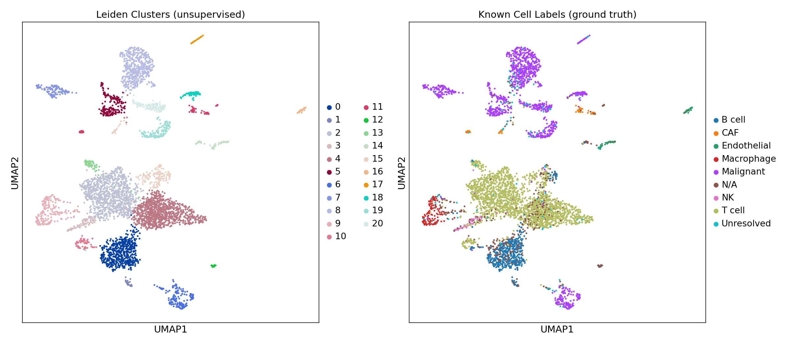
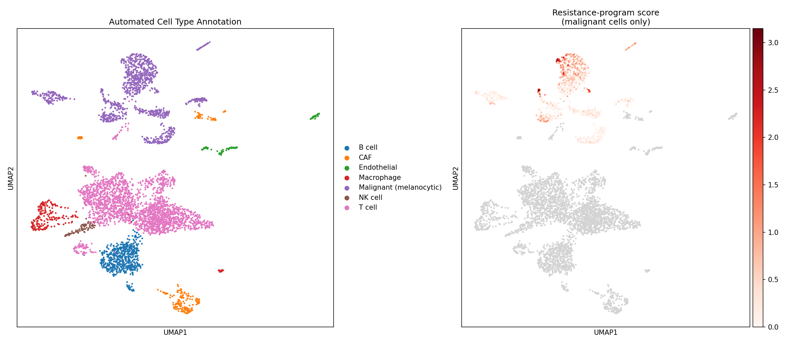
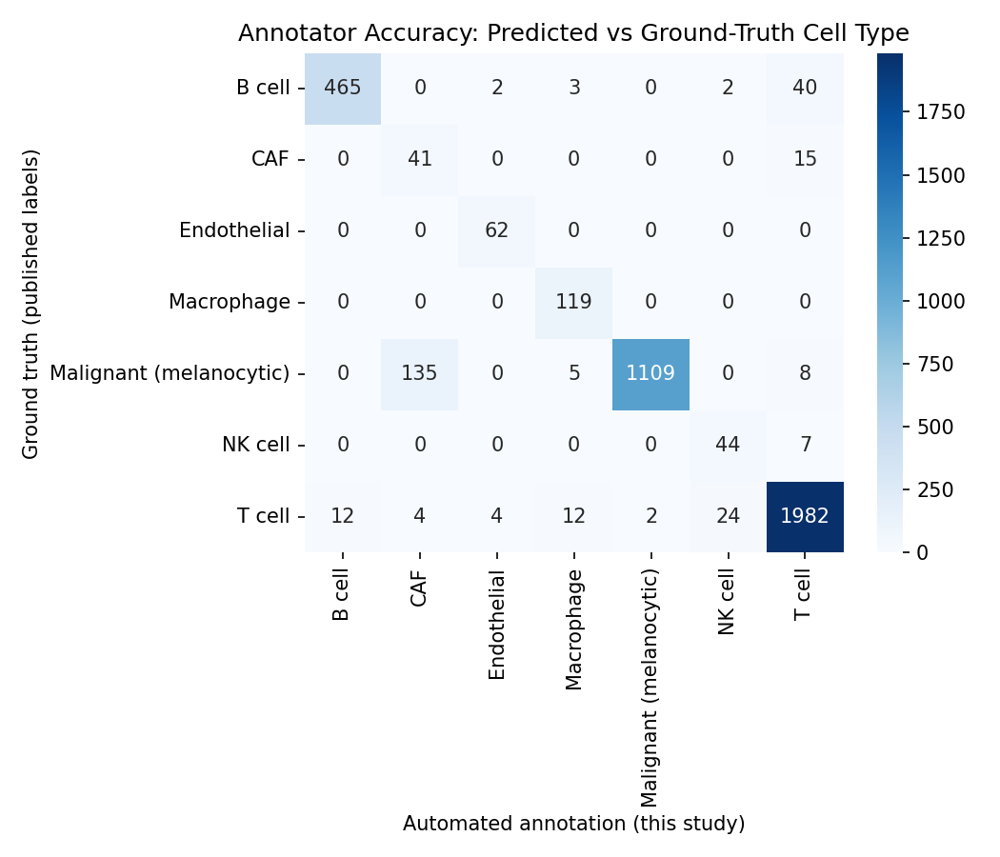
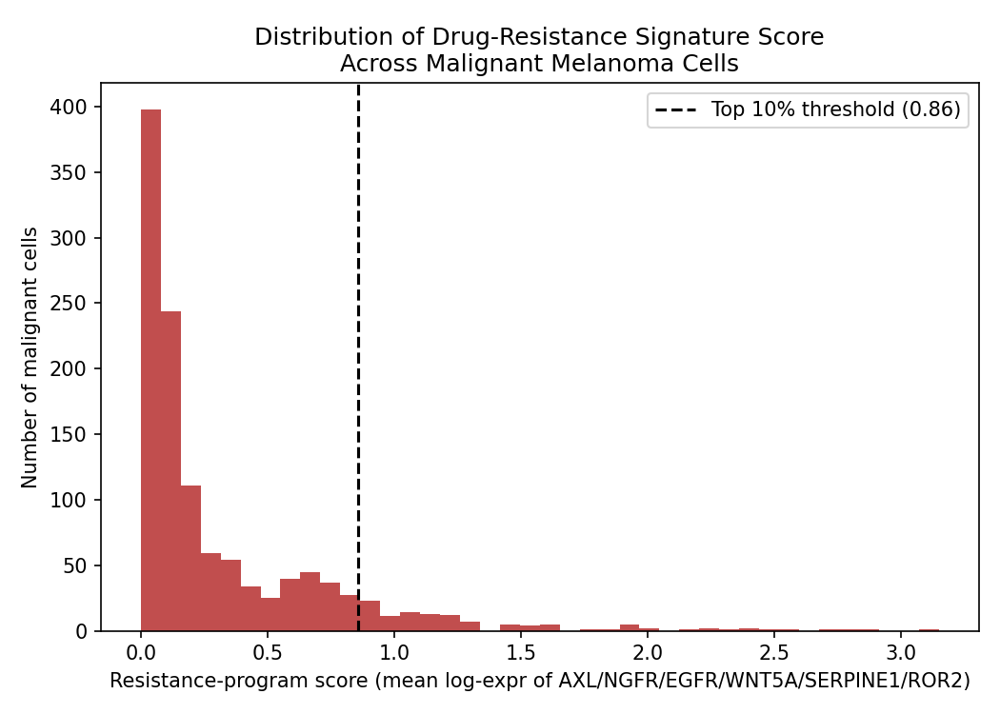
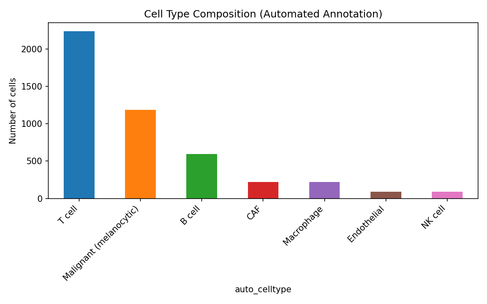
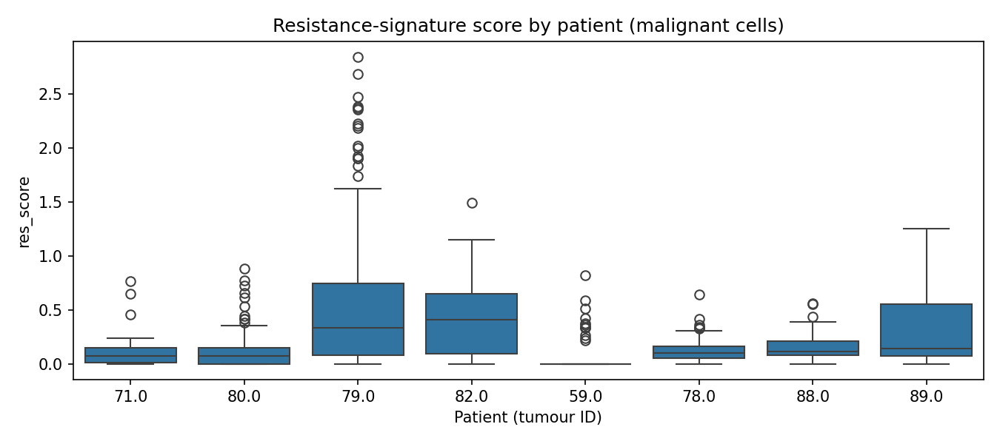

# Marker-based Cell Type Annotation and Resistance-Signature Scoring in Melanoma scRNA-seq (GSE72056)

A Python (Scanpy) pipeline that clusters single cells from melanoma tumours, labels the clusters automatically using curated marker genes, checks those labels against the published annotations, and scores malignant cells for a literature-derived drug-resistance gene signature.

## Question

Bulk RNA-seq averages expression over all cells in a tumour. Can single-cell data be used to (1) identify the cell types present with a simple, transparent marker-based annotator, and (2) look at how a known drug-resistance gene program varies across malignant cells?

## Data

- **GSE72056**, Tirosh et al., *Science* 2016: 4,645 single cells from 19 melanoma patients.
- Source: https://www.ncbi.nlm.nih.gov/geo/query/acc.cgi?acc=GSE72056
- Values are log2(TPM/10 + 1), not raw counts. The dataset ships with the authors' labels (malignant / non-malignant and cell type), which are used here only for validation.
- The data file is **not** included in this repository. Download it from GEO and save it as `data/GSE72056.txt`.

## Methods

| Step | Script | What it does |
|------|--------|--------------|
| 1 | `load_data.py` | Separates metadata rows from the expression matrix, builds an AnnData object with the published labels attached |
| 2 | `pipeline.py` | QC filtering, 2,000 highly variable genes, scaling, PCA (40 components), neighbour graph, Leiden clustering (resolution 0.5), UMAP |
| 3 | `annotator.py` | Scores each cluster against marker panels for 7 cell types (T, B, NK, macrophage, CAF, endothelial, malignant) and assigns the top-scoring label; scores malignant cells for a 6-gene resistance signature (AXL, NGFR, EGFR, WNT5A, SERPINE1, ROR2) |
| 4 | `validate.py` | Compares automated labels with the published labels (accuracy, confusion matrix) |
| 5 | `final_figures.py` | Confusion-matrix heatmap, resistance-score histogram, cell-type composition bar chart |
| 6 | evaluate_more.py | Per-class precision/recall and resistance score by patient |

## Results

- Automated annotation agreed with the published labels for **93.3%** of cells with a known label (n = 4,097; see the confusion matrix).
- 1,189 cells were annotated as malignant.
- 21 Leiden clusters were found. Malignant cells formed several separate clusters, which fits patient-specific structure.
- Resistance-signature scores vary across malignant cells, but the signature is not specific to tumour cells: the highest cluster score was in a CAF (fibroblast) cluster.

### Clustering vs published labels


### Automated annotation and resistance score


### Annotator accuracy (confusion matrix)


### Resistance-signature score distribution


### Cell type composition

### Per-class performance
Overall accuracy is 93%, but macro F1 is 0.83. CAF is the weakest class (precision 0.23, recall 0.73), mostly because 135 malignant cells were labelled CAF. NK cell precision is 0.63. T cell, B cell and malignant classes all reach F1 of 0.94–0.97.

### Resistance score by patient
Resistance-signature scores differ between patients: patient identity explains about 18% of the variance in malignant cells. Of the 119 cells in the top 10% of scores, 103 (87%) come from a single patient (tumour 79), which contributes about 44% of the malignant cells analysed. The high-score group is therefore mainly patient-specific, not a rare subpopulation shared across patients. Cells within patient 79 still vary widely in score.



## Limitations

- **Resistance "high" group is defined by a percentile cut-off,** so its size is fixed by construction. The per-patient analysis shows it is dominated by one patient. P-values from the Kruskal-Wallis test treat cells as independent, which overstates significance because cells from one patient are correlated.
- **Patient effects.** Malignant cells in this dataset tend to group by patient. No batch correction was applied, so some clustering structure and signature variation may reflect patient identity rather than resistance biology.
- **Signature genes come from the literature** and were not validated on this dataset.
- **Accuracy is dominated by the largest classes.** Per-class precision and recall should be reported alongside overall accuracy.
- Leiden clustering is a classical method; no deep-learning approach was tested.
- **Malignant cells misclassified as CAF.** In the confusion matrix, 135 ground-truth malignant cells were labelled as CAF, so the annotator is weakest on this class. Overall accuracy is driven by the large T and B cell groups.

## How to run

```bash
pip install -r requirements.txt
mkdir -p data
# download GSE72056 from GEO and save as data/GSE72056.txt
python load_data.py
python pipeline.py
python annotator.py
python validate.py
python final_figures.py
python evaluate_more.py
```

## Note on tooling

This pipeline was built with AI assistance (Claude) for code generation and drafting. The dataset, research question, and interpretation were chosen and reviewed by the author, who can explain each step.

## Author

Siddharth Bawiskar, B.Tech Biotechnology, Parul University
